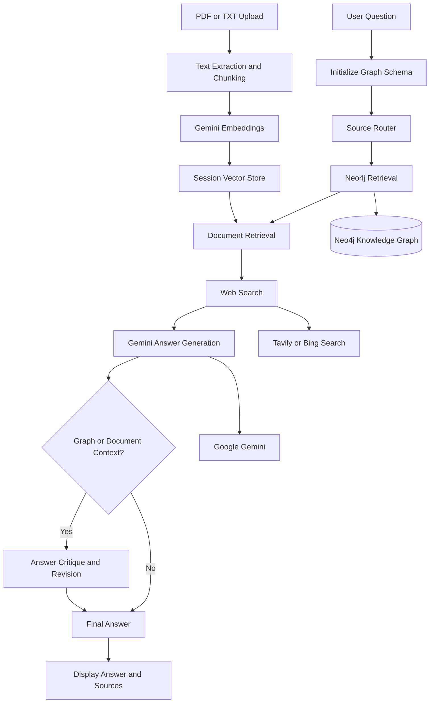
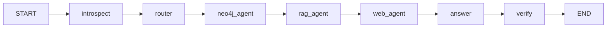

# 🎬 Agentic Movie Research System

A movie-focused AI research assistant that combines a **Neo4j knowledge graph**, uploaded movie scripts and documents, web search, and **Google Gemini** to answer movie-related questions.

The application uses **LangGraph** to orchestrate retrieval and answer-generation steps, while a **Streamlit interface** allows users to interact with the assistant, upload documents, and inspect the information retrieved from different sources.


## ✨ Features

- **Hybrid Movie Research:** Combines structured knowledge from Neo4j with information from web search to answer movie-related questions.
- **Knowledge Graph Retrieval:** Searches movie-related entities and their relationships using Neo4j.
- **AI-Assisted Graph Query Planning:** Uses Google Gemini to help generate graph retrieval plans and read-only Cypher queries.
- **Document Question Answering:** Upload PDF and TXT files and ask questions about their contents.
- **Semantic Document Search:** Uses Gemini embeddings and similarity search to retrieve relevant document sections.
- **Web Search Integration:** Retrieves current information using Tavily, with a Bing-backed `ddgs` fallback.
- **Answer Generation:** Uses Google Gemini to synthesize retrieved information into natural-language responses.
- **Answer Verification:** Supports AI-powered critique and revision using retrieved graph and document context.
- **Retrieval Transparency:** Displays selected sources, graph matches, document results, web context, and search errors.
- **Optional LangSmith Tracing:** Supports tracing for monitoring and debugging model workflows.
- **Command-Line Interface:** Includes an interactive movie-question workflow through `core/main.py`.

## 🏗️ Architecture

The application combines structured graph retrieval, semantic document retrieval, and web search in a LangGraph-orchestrated workflow.


### Main workflow



### Retrieval sources

| Source | Description |
|---|---|
| Neo4j Knowledge Graph | Retrieves movie entities, properties, and relationships. |
| Uploaded Documents | Extracts and retrieves relevant sections from PDF and TXT files. |
| Web Search | Retrieves external information through Tavily or the `ddgs` fallback. |
| Google Gemini | Supports graph-query planning, embeddings, answer synthesis, and answer critique. |

## 🧠 LangGraph Workflow

The workflow is defined in `core/rag_pipeline.py` using a typed shared state.



The shared workflow state carries information such as:

- User question
- Selected retrieval sources
- Neo4j schema information
- Graph retrieval context and result counts
- Uploaded-document retrieval context
- Web search context and errors
- Session document store
- Generated answer and verification information

The source router determines which retrieval sources are relevant to a question. Each retrieval node performs its work when its source is selected.

## 🛠️ Technologies and Integrations

| Technology | Purpose |
|---|---|
| Python | Main application language |
| Streamlit | Interactive chat interface and document uploads |
| LangGraph | Workflow orchestration and shared state management |
| LangChain | LLM and retrieval integrations |
| Neo4j | Movie knowledge graph database |
| Google Gemini | Language model, embeddings, and answer generation |
| Tavily | Primary web-search integration when configured |
| `ddgs` | Bing-backed web-search fallback |
| LangSmith | Optional LLM tracing and observability |
| PyPDF | PDF text extraction |
| LangChain Text Splitters | Document chunking |
| NumPy | Embedding similarity calculations |

### Model configuration

The default model settings in `core/config.py` are:

- **Language model:** `gemini-3.8-flash`
- **Embedding model:** `gemini-embedding-001`

These settings can be configured through environment variables.

## 📁 Project Structure

```text
.
├── app.py
├── core/
│   ├── agent_hub.py
│   ├── config.py
│   ├── doc_processor.py
│   ├── langsmith_setup.py
│   ├── llm_utils.py
│   ├── main.py
│   ├── rag_pipeline.py
│   └── verification.py
├── document_store/
│   ├── session_store.py
│   └── vector_store.py
├── knowledge_graph/
│   ├── neo4j_reader.py
│   └── retriever.py
├── prompt/
│   └── agent_prompts.py
├── tests/
│   ├── manual_test.py
│   ├── test_agent_routing.py
│   └── test_llm_utils.py
├── .env.example
├── graph-diagram.png
├── hybrid-rag-demo.png
└── requirements.txt
```

### Core modules

| Module | Responsibility |
|---|---|
| `app.py` | Streamlit application and user interface |
| `core/agent_hub.py` | Source routing, retrieval agents, and answer synthesis |
| `core/rag_pipeline.py` | LangGraph workflow and shared state |
| `core/doc_processor.py` | PDF/TXT extraction and text chunking |
| `core/verification.py` | Answer critique and revision |
| `core/llm_utils.py` | Gemini response normalization |
| `core/config.py` | Application configuration |
| `document_store/session_store.py` | Session-scoped document vector storage |
| `document_store/vector_store.py` | Embeddings and similarity calculations |
| `knowledge_graph/neo4j_reader.py` | Neo4j database operations |
| `knowledge_graph/retriever.py` | Graph retrieval and query-plan handling |
| `prompt/agent_prompts.py` | Prompts used by the retrieval and answer components |
| `core/main.py` | Interactive command-line interface |

## ⚙️ Installation and Configuration

### Prerequisites

Make sure you have:

- Python installed
- A reachable Neo4j database containing movie-related data
- A Google Gemini API key
- Optional: a Tavily API key
- Optional: a LangSmith API key

### 1. Clone the repository

```powershell
git clone https://github.com/Fraol-M/rag-demonstration.git
cd rag-demonstration
```

### 2. Create a virtual environment

```powershell
py -m venv .venv
```

Activate it:

```powershell
.\.venv\Scripts\Activate.ps1
```

If PowerShell blocks activation, use the environment's Python executable directly.

### 3. Install dependencies

```powershell
python -m pip install --upgrade pip
python -m pip install -r requirements.txt
```

### 4. Configure environment variables

Create your environment file:

```powershell
Copy-Item .env.example .env
```

Open `.env`:

```powershell
notepad .env
```

Add your configuration:

```dotenv
# Neo4j database
NEO4J_URI=bolt://localhost:7687
NEO4J_USER=neo4j
NEO4J_PASSWORD=your_neo4j_password

# Google Gemini
GEMINI_API_KEY=your_gemini_api_key
GEMINI_MODEL=gemini-3.8-flash
GEMINI_EMBEDDING_MODEL=gemini-embedding-001

# Optional: Tavily web search
TAVILY_API_KEY=

# Optional: LangSmith tracing
LANGSMITH_TRACING=false
LANGSMITH_API_KEY=
LANGSMITH_PROJECT=llm-demonstration
LANGSMITH_ENDPOINT=https://api.smith.langchain.com
```

Replace the example values with your actual credentials.

**Important:** The application requires a configured Neo4j database and Gemini API key. Keep your `.env` file private and never commit API keys or passwords to GitHub.

## 🚀 Running the Application

From the project root, run:

```powershell
streamlit run app.py
```

Streamlit will start the application and provide a local browser address.

### Using the application

1. Open the Streamlit application in your browser.
2. Enter a movie-related question in the chat.
3. Upload a PDF or TXT document when you want to ask questions about its contents.
4. Ask questions about movie information, relationships, or uploaded material.
5. Inspect the retrieval details to see the sources and context used.
6. Explore the available schema and workflow information in the interface.

### Running the command-line interface

The project also provides an interactive CLI:

```powershell
python -m core.main
```

## 🧪 Running Tests

Run the project's unit and regression tests:

```powershell
python -m unittest discover -s tests -p "test_*.py" -v
```

You can also run the workflow construction smoke check:

```powershell
$env:PYTHONIOENCODING = "utf-8"
python tests/manual_test.py
```

For end-to-end retrieval, ensure that your API credentials, network connection, and Neo4j database are configured correctly.

## 💡 Engineering Highlights

The project brings together several practical AI engineering concepts:

- **Retrieval-Augmented Generation (RAG):** Grounds generated answers in retrieved information rather than relying only on the language model's internal knowledge.
- **Hybrid Retrieval:** Combines structured knowledge-graph information with semantic search over uploaded documents and external web results.
- **Workflow Orchestration:** Uses LangGraph to organize retrieval and answer-generation steps around shared state.
- **Semantic Search:** Converts document chunks into embeddings and retrieves relevant content through similarity calculations.
- **LLM-Assisted Query Planning:** Uses Gemini to support graph retrieval planning.
- **Answer Critique:** Uses a model-assisted verification step to review and revise answers supported by graph and document context.
- **Observability:** Supports LangSmith tracing to help inspect model execution.

## 🔮 Future Improvements

Potential directions for extending the system include:

- More flexible intent classification and source selection.
- Improved graph-query validation and database security.
- Persistent storage for uploaded documents and conversation history.
- Support for multiple uploaded documents.
- Stronger source attribution and citation validation.
- Expanded integration testing and retrieval evaluation.

## 📄 License

Please refer to the repository owner for licensing and reuse permissions. Check the repository for an applicable license before redistributing or reusing the project.

---

**Built with Python, LangGraph, Neo4j, Google Gemini, and Streamlit.**
