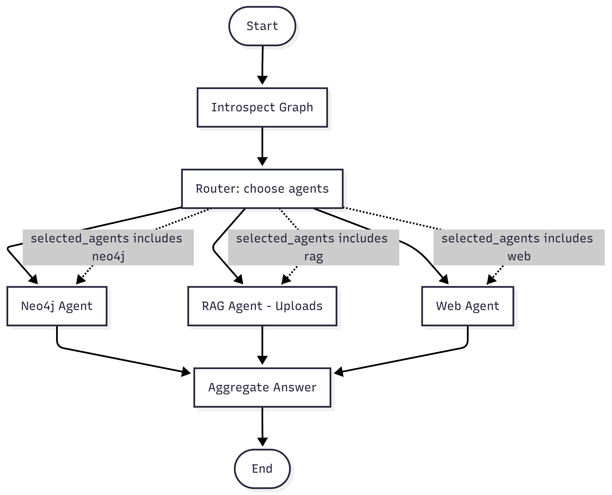
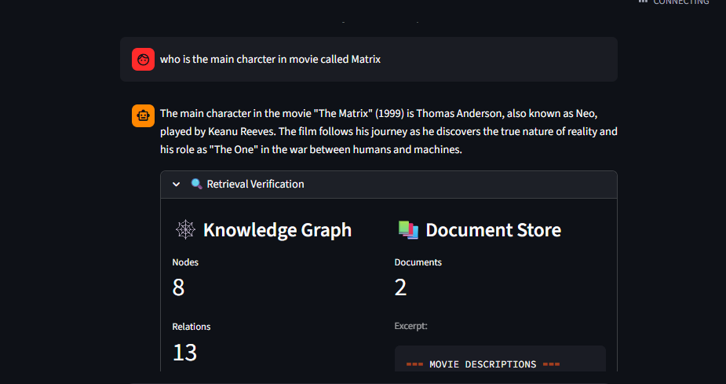

# Movies Knowledge Assistant (RAG Demonstration)

A hybrid Retrieval-Augmented Generation (RAG) system for movies, powered by **Neo4j** (Knowledge Graph) and **Gemini** (Vector Search over uploaded files). This project demonstrates a pipeline using **LangGraph** to orchestrate retrieval from structured (graph) and unstructured (user-provided text/PDF) data sources.

## Features

- **Hybrid Retrieval**: Combines Graph RAG (structured relationships) and Vector Search from uploaded documents.
- **LangGraph Pipeline**: Orchestrated workflow with introspection, entity identification, and parallel retrieval.
- **Neo4j Integration**: Connects to a Neo4j database to query movie knowledge graphs.
- **Gemini Powered**: Uses Google's Gemini models for embedding generation and final answer synthesis.
- **Interactive UI**: Built with Streamlit for easy interaction and visualization.
- **LangSmith Tracing**: Optional run tracing for observability and debugging.

## Architecture

The system follows a multi-path retrieval strategy:



## Demonstration

The following screenshot shows the assistant aggregating data from both the **Knowledge Graph** (nodes/relations) and the **Uploaded Document Store** (PDF/TXT chunks) to answer a complex query.



## Installation

1.  **Clone the repository:**
    ```bash
    git clone https://github.com/Fraol-M/rag-demonstration.git
    cd rag-demonstration
    ```

2.  **Set up a virtual environment:**
    ```bash
    python -m venv venv
    # On Windows:
    .\venv\Scripts\activate
    # On macOS/Linux:
    source venv/bin/activate
    ```

3.  **Install dependencies:**
    ```bash
    pip install -r requirements.txt
    ```

4.  **Configure environment variables:**
    Create a `.env` file in the root directory with your credentials:
    ```ini
    NEO4J_URI=bolt://localhost:7687
    NEO4J_USER=neo4j
    NEO4J_PASSWORD=your_password
    GEMINI_API_KEY=your_gemini_api_key
    GEMINI_EMBEDDING_MODEL=gemini-embedding-001
    LANGSMITH_TRACING=true
    LANGSMITH_API_KEY=your_langsmith_api_key
    LANGSMITH_PROJECT=llm-demonstration
    LANGSMITH_ENDPOINT=https://api.smith.langchain.com
    ```

### Optional: Enable LangSmith tracing

When LangSmith variables are set, traces are captured automatically from both Streamlit and CLI runs.

- Set `LANGSMITH_TRACING=true`
- Set `LANGSMITH_API_KEY`
- Optionally set `LANGSMITH_PROJECT` and `LANGSMITH_ENDPOINT`

## Usage

Run the Streamlit app:
```bash
streamlit run app.py
```

The application will launch in your browser. You can:
- Ask questions about movies ("Who directed The Matrix?").
- Upload a PDF/TXT file and ask questions grounded in that file.
- View the "Schema" and "Pipeline" tabs in the sidebar.
- Inspect the retrieval details (Graph Context vs. Document Context).
