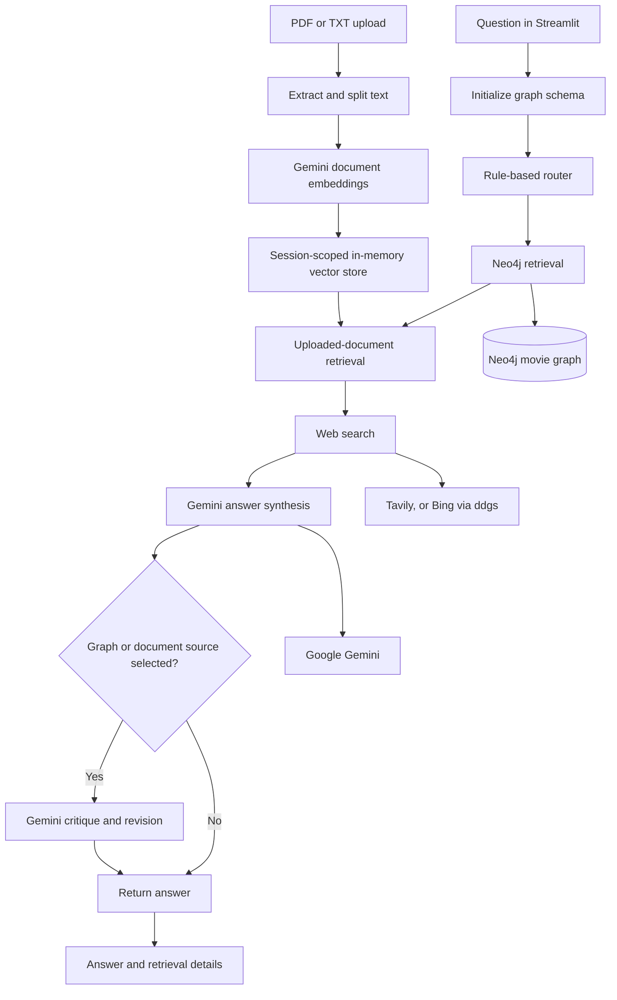
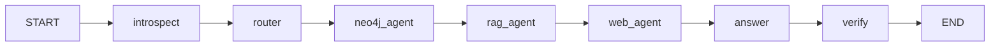

# Agentic Movie Research System

A movie-focused research assistant that combines a Neo4j knowledge graph, uploaded scripts and documents, web search, and Google Gemini. A Streamlit chat interface presents the answer alongside retrieval details so users can see which sources were searched.

The application is built around a typed LangGraph state and explicit retrieval nodes. Its routing is currently rule-based, while Gemini helps plan graph retrieval and synthesize answers. This distinction keeps the implementation transparent: the workflow is orchestrated and LLM-assisted, but it is not an autonomous or parallel multi-agent system.


## Features

- **Hybrid movie research:** Standard movie questions use both Neo4j and web search. Questions that explicitly request current or recent information are routed to web search.
- **Movie knowledge graph:** Searches configured text properties in Neo4j, expands matching nodes to neighboring relationships, and can use a Gemini-generated read-only Cypher plan.
- **Uploaded-document Q&A:** Accepts PDF and TXT files, extracts and splits their text, embeds the resulting chunks with Gemini, and retrieves the three most similar chunks for a question.
- **Web search:** Uses Tavily when configured, with a Bing-backed `ddgs` fallback. Search results are bounded and include source URLs in the context passed to the answer model.
- **Answer verification:** Graph- and document-assisted answers can go through a Gemini critique and revision step. Web-only answers skip this step.
- **Retrieval visibility:** The Streamlit UI displays the selected sources, graph and document matches, web context, and search errors.
- **Optional tracing:** LangSmith tracing can be enabled for observability.
- **Command-line interface:** `core/main.py` provides a separate interactive movie-question workflow.

## Architecture



The retrieval and answer nodes are connected sequentially in LangGraph. If a source is not selected, its node returns empty context; the graph is not dynamically branched or run in parallel. The uploaded-document vector store and chat history live in Streamlit session state rather than a persistent document database.

## LangGraph workflow and state

`core/rag_pipeline.py` defines a `TypedDict` state and compiles this workflow:



The graph state carries the user question, selected route and agents, Neo4j schema and result counts, graph/document/web context, the session vector store, answer, verification, and error information. The router selects sources using question keywords and upload availability. Each retrieval node skips its work when its source is not selected.

## Tools and integrations

| Component | Role in this implementation |
|---|---|
| Streamlit | Chat UI, PDF/TXT upload, session history, and retrieval inspection |
| LangGraph | Sequential workflow orchestration and typed shared state |
| Neo4j Python driver | Movie-graph schema inspection, keyword matching, neighborhood expansion, and planned Cypher execution |
| Google Gemini via LangChain | Graph-query planning, document embeddings, answer synthesis, and optional critique/revision |
| Tavily | Optional primary web-search provider when `TAVILY_API_KEY` is configured |
| `ddgs` | Bing-backed web-search fallback |
| LangSmith | Optional tracing when tracing is enabled and an API key is configured |
| PyPDF and LangChain text splitters | PDF text extraction and document chunking |
| NumPy | In-memory embedding similarity calculations |

The default model settings in `core/config.py` are `gemini-3.8-flash` for language-model calls and `gemini-embedding-001` for embeddings. Both can be configured through environment variables.

## Engineering contributions and implementation decisions

The current codebase demonstrates the following implementation work without implying that every component originated in this iteration:

- Normalizes structured Gemini response content into readable text before displaying answers or parsing graph plans.
- Routes regular movie questions to both graph and web sources, time-sensitive questions to web search, and explicit uploaded-document questions to the document retriever when a file is available.
- Uses Tavily when configured and falls back to Bing search through `ddgs` when Tavily is unavailable or not configured.
- Keeps each retrieval source visible in the UI to make empty results and search failures easier to diagnose.
- Includes focused regression tests for response normalization, routing, answer formatting, and successful fallback-search status.

The graph and document retrieval mechanisms, Streamlit application structure, and LangGraph workflow are described as implemented system components rather than claimed as individually authored from scratch.

## Project structure

```text
.
├── app.py                         # Streamlit chat application
├── core/
│   ├── agent_hub.py               # Routing, retrieval agents, answer synthesis
│   ├── config.py                  # Environment-backed settings
│   ├── doc_processor.py           # PDF/TXT extraction and chunking
│   ├── langsmith_setup.py         # Optional tracing configuration
│   ├── llm_utils.py               # Gemini response text normalization
│   ├── main.py                    # Interactive CLI
│   ├── rag_pipeline.py            # LangGraph state and workflow
│   └── verification.py            # Answer critique and revision
├── document_store/
│   ├── session_store.py           # Session-scoped in-memory vector store
│   └── vector_store.py            # Gemini embeddings and cosine similarity
├── knowledge_graph/
│   ├── neo4j_reader.py            # Neo4j access and graph operations
│   └── retriever.py               # Graph-plan parsing and execution
├── prompt/
│   └── agent_prompts.py           # Graph and answer prompts
├── tests/
│   ├── manual_test.py             # Workflow-construction smoke check
│   ├── test_agent_routing.py      # Routing and agent behavior tests
│   └── test_llm_utils.py          # Response-normalization tests
├── .env.example                   # Environment-variable template
├── graph-diagram.png              # Workflow illustration for the UI
├── hybrid-rag-demo.png            # Example application image
└── requirements.txt
```

## Installation and configuration

### Requirements

- Python with `venv` and `pip`
- A reachable Neo4j instance containing a movie graph
- A Google Gemini API key
- Optional: a Tavily API key for primary web search
- Optional: a LangSmith API key for tracing

The application does not create or seed a Neo4j database. Configure `NEO4J_URI`, `NEO4J_USER`, and `NEO4J_PASSWORD` for an existing database.

### Windows PowerShell

From the project directory:

```powershell
py -m venv .venv
.\.venv\Scripts\Activate.ps1
python -m pip install --upgrade pip
python -m pip install -r requirements.txt
Copy-Item .env.example .env
notepad .env
```

If PowerShell prevents virtual-environment activation, you can invoke the environment's Python directly instead:

```powershell
.\.venv\Scripts\python.exe -m pip install -r requirements.txt
```

Set the required values in `.env`:

```dotenv
NEO4J_URI=bolt://localhost:7687
NEO4J_USER=neo4j
NEO4J_PASSWORD=replace_with_your_neo4j_password

GEMINI_API_KEY=replace_with_your_gemini_api_key
GEMINI_MODEL=gemini-3.8-flash
GEMINI_EMBEDDING_MODEL=gemini-embedding-001

# Optional: leave blank to use the ddgs Bing fallback.
TAVILY_API_KEY=

# Optional LangSmith tracing.
LANGSMITH_TRACING=false
LANGSMITH_API_KEY=
LANGSMITH_PROJECT=llm-demonstration
LANGSMITH_ENDPOINT=https://api.smith.langchain.com
```

`NEO4J_PASSWORD` and `GEMINI_API_KEY` are required by the app's configuration check. To use LangSmith, enable tracing and supply its API key. Keep `.env` private; it is excluded from Git.

## Run the application

Start the Streamlit app from the repository root:

```powershell
streamlit run app.py
```

Use the browser UI to ask a movie question, upload a PDF or TXT script, inspect retrieval details, and ask questions that request current information. In the sidebar, the app also displays the Neo4j schema and a pipeline illustration.

To use the interactive command-line interface instead:

```powershell
python -m core.main
```

The CLI invokes the graph pipeline without a Streamlit upload session; it does not provide the UI's document-upload workflow.

## Tests and checks

Run the unit and regression tests:

```powershell
python -m unittest discover -s tests -p "test_*.py" -v
```

The manual smoke check verifies that the LangGraph workflow can be built. It intentionally does not make live model or database requests:

```powershell
$env:PYTHONIOENCODING = "utf-8"
python tests/manual_test.py
```

End-to-end retrieval requires valid API credentials, network access, and a reachable Neo4j database. A passing unit test or workflow-build check does not validate those external services.

## Assignment requirements and implementation status

No separate assignment brief or grading rubric is included in the repository. The table below evaluates the capabilities described by this project's source code and UI; it should not be read as a claim about an unseen rubric.

| Capability | Status | Evidence and scope |
|---|---|---|
| Movie question answering | Implemented | LangGraph retrieval and Gemini answer synthesis are wired into the Streamlit UI and CLI. Answer quality depends on retrieved evidence and configured services. |
| Knowledge-graph retrieval | Implemented | Neo4j schema inspection, text-property keyword search, and one-hop relationship expansion are present. |
| Graph query planning | Partially implemented | Gemini can propose search terms or read-only Cypher. Cypher safety checks use keyword screening rather than a full Cypher parser or database-level read-only transaction. |
| Uploaded PDF/TXT retrieval | Implemented | Text extraction, 1,000-character chunks with overlap, Gemini embeddings, and top-three in-memory similarity search are present. The UI currently replaces the prior document when another file is uploaded. |
| Current web information | Implemented | Tavily is optional; the `ddgs` Bing backend is the fallback. Availability and result quality depend on external providers and the network. |
| Source citations | Partially implemented | Web source URLs are included in retrieval context and the answer prompt asks Gemini to cite them. Citation format and factual support are not validated programmatically. |
| Answer verification | Partially implemented | Graph/document answers can be critiqued and revised with Gemini. Web context is not passed to the verifier, and verification remains model-generated. |
| Multi-agent orchestration | Partially implemented | The system has source-specific workflow nodes in LangGraph. Routing is keyword-based and the nodes run sequentially; this is not autonomous planning or parallel agent execution. |
| Persistence and multi-user document management | Not implemented | Uploaded chunks and chat messages live in Streamlit session state and are not backed by a persistent document store. |
| Automated external-service tests | Not implemented | The unit tests focus on local behavior; the manual smoke check builds the workflow but skips live execution. |

## Evaluation, limitations, and future improvements

### Current limitations

- Rule-based routing can miss user intent or select a source unnecessarily.
- Neo4j results depend on the existing graph schema and configured text properties; the project does not ship a database seed or migration.
- Uploaded files are processed one at a time in the UI, held in memory for the active session, and embedded through API calls.
- The Cypher validator is a lightweight keyword check and should not be treated as a security boundary. Use least-privilege Neo4j credentials and strengthen query validation before exposing this system to untrusted users.
- Search results and answers depend on third-party service availability, API quotas, and model behavior.
- Citations are prompted rather than checked against generated claims, and the verification step does not use web evidence.
- The existing tests do not exercise live Gemini, Tavily/Bing, or Neo4j integrations.

### Potential next steps

- Replace keyword routing with a tested intent classifier or a structured LLM router, while retaining explicit routing observability.
- Use read-only Neo4j transactions and a proper Cypher parser or constrained query interface.
- Add integration tests with mocked provider boundaries and a documented Neo4j fixture.
- Support multiple uploaded files, persistent storage, and clear document lifecycle controls.
- Validate generated citations and verify answers against all selected sources, including web results.
- Add application-level timeouts, user-facing error handling, and operational metrics for external-service failures.

## License and attribution

There is no `LICENSE`, `NOTICE`, or `COPYING` file in the repository, so the project currently declares no open-source license. Do not assume that it may be redistributed under a particular license. Before publishing or reusing the code, confirm the applicable rights with the repository owner and preserve any copyright, attribution, and license notices required for reused or inherited material.
